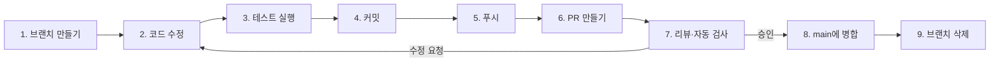
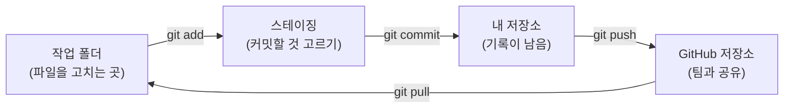
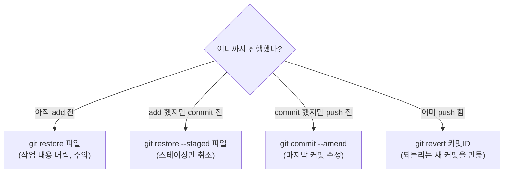
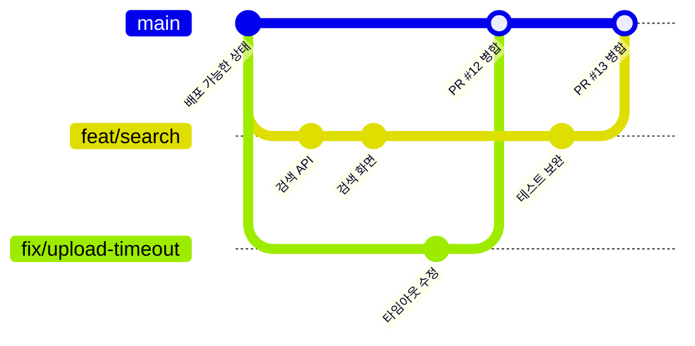
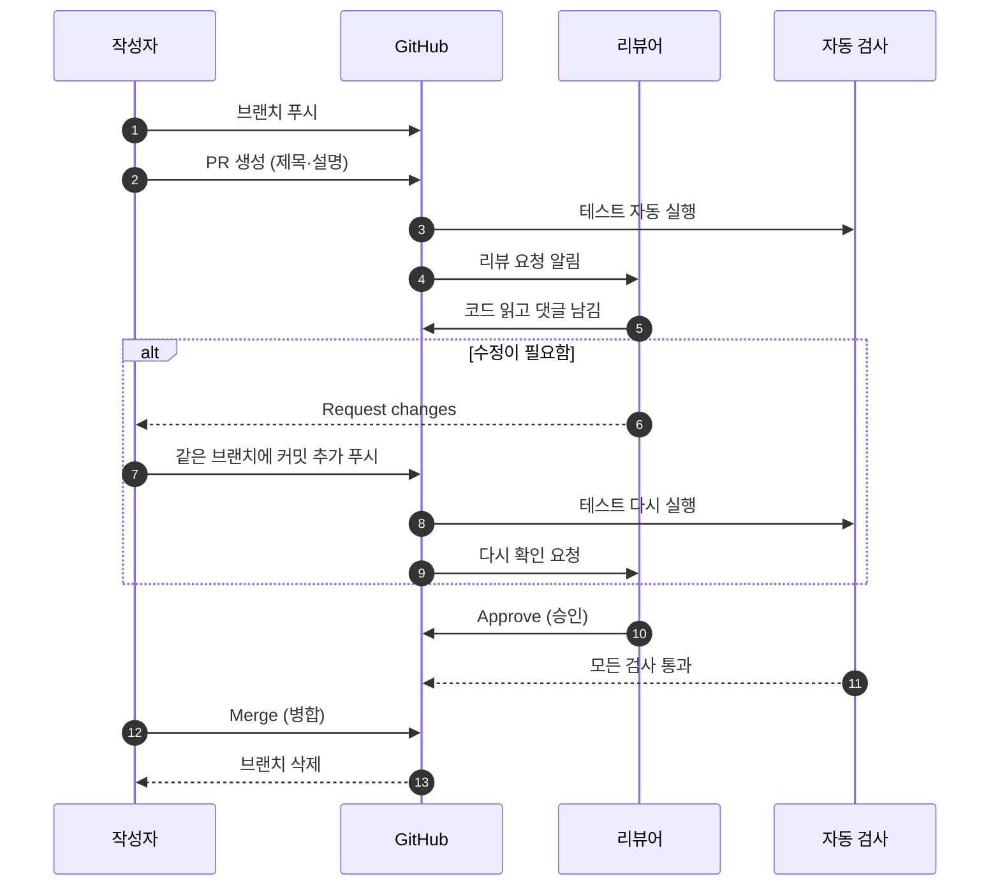
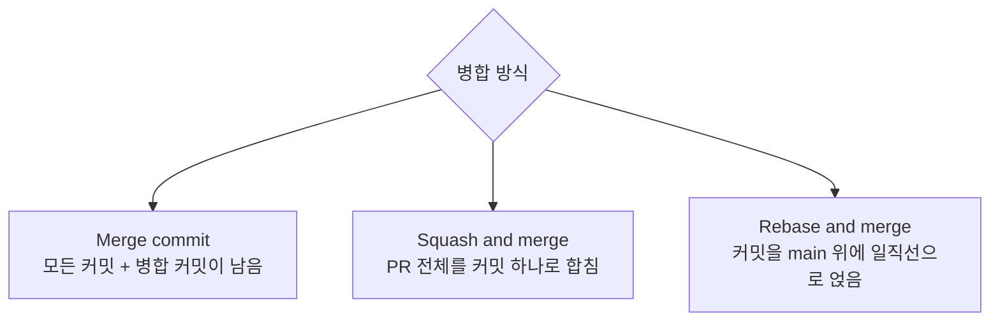
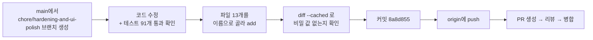

# 커밋과 PR로 협업하는 방법

LabNote 개발자를 위한 버전 관리 안내입니다. **커밋**은 내 컴퓨터에 변경 기록을 남기는 일이고, **PR(Pull Request)** 은 그 변경을 main에 합쳐 달라고 요청하고 검토받는 절차입니다.

> 그림은 GitHub에서 열면 바로 그려집니다(Mermaid). 일부 에디터에서는 코드로 보일 수 있습니다.

---

## 1. 한눈에 보기



| 단계 | 하는 일 | 대표 명령 |
|---|---|---|
| 1 | main에서 작업용 브랜치를 만든다 | `git switch -c feat/search` |
| 2~3 | 코드를 고치고 테스트로 확인한다 | `pytest`, `npx tsc --noEmit` |
| 4 | 변경을 의미 있는 단위로 기록한다 | `git add`, `git commit` |
| 5 | 브랜치를 GitHub에 올린다 | `git push -u origin feat/search` |
| 6 | main에 합쳐 달라는 요청서를 만든다 | GitHub의 **Create pull request** |
| 7 | 동료가 읽고 의견을 남긴다 | 댓글, Approve |
| 8~9 | 승인되면 합치고 브랜치를 지운다 | **Merge**, **Delete branch** |

---

## 2. 커밋 절차

### 2.1 변경이 지나가는 네 곳



- **작업 폴더:** 지금 보이는 파일. 아직 아무 기록도 없습니다.
- **스테이징:** "이번 커밋에 넣을 파일"을 고르는 대기 장소입니다. 관련 없는 변경을 빼는 데 씁니다.
- **내 저장소:** 커밋하면 여기에 영구히 기록됩니다. 아직 나만 가지고 있습니다.
- **GitHub 저장소:** 푸시해야 다른 사람이 볼 수 있습니다.

### 2.2 커밋하는 순서

```bash
git status                      # 무엇이 바뀌었는지 확인
git diff                        # 바뀐 내용을 눈으로 확인
git add backend/app/main.py frontend/src/App.tsx   # 이번 커밋에 넣을 파일만 이름으로 선택
git diff --cached               # 스테이징된 내용 최종 확인 (비밀 값이 없는지 포함)
git commit -m "제목" -m "자세한 설명"
```

**파일을 이름으로 골라 담으세요.** `git add -A`나 `git add .`는 `.env`, 인증키, 개발용 DB처럼 올리면 안 되는 파일까지 한꺼번에 담을 수 있습니다.

### 2.3 좋은 커밋의 조건

1. **한 커밋에는 한 가지 목적만.** 기능 추가와 오타 수정을 섞지 않습니다.
2. **커밋마다 테스트가 통과합니다.** 커밋 하나만 골라 되돌려도 앱이 깨지지 않아야 합니다.
3. **비밀 값은 절대 넣지 않습니다.** 비밀번호, API 키, `.env`, 개발 DB는 `.gitignore`로 막습니다.
4. **작게, 자주 합니다.** 며칠 치를 한 번에 커밋하면 리뷰도 되돌리기도 어렵습니다.

### 2.4 커밋 메시지 쓰는 법

```
제목: 무엇을 했는지 한 줄 (50자 안팎, 마침표 없음)
(빈 줄)
본문: 왜 바꿨는지, 어떤 영향이 있는지 (필요할 때만)
```

| 나쁜 예 | 좋은 예 |
|---|---|
| `update` | `Block public access to project data files` |
| `fix bug` | `Fix upload timeout that duplicated attached files` |
| `여러 가지 수정` | `Add per-project criteria for note activity alerts` |

**본문에는 "무엇"보다 "왜"를 씁니다.** 무엇을 바꿨는지는 코드 차이(diff)에 이미 나옵니다. 왜 그렇게 했는지는 메시지에만 남습니다.

### 2.5 커밋 후 되돌리기



> 이미 푸시한 기록을 `reset --hard`나 `push --force`로 지우지 마세요. 다른 사람의 작업이 꼬일 수 있습니다. 푸시한 뒤에는 `revert`가 안전합니다.

---

## 3. 브랜치와 병합

### 3.1 브랜치 모델



- **main:** 언제나 실행되고 테스트가 통과하는 브랜치입니다. 여기에 직접 올리지 않고, PR로만 합칩니다.
- **작업 브랜치:** 일 하나당 브랜치 하나. main에서 갈라져 나왔다가 PR로 돌아옵니다.

### 3.2 브랜치 이름

| 접두어 | 용도 | 예 |
|---|---|---|
| `feat/` | 새 기능 | `feat/note-history` |
| `fix/` | 버그 수정 | `fix/upload-timeout` |
| `chore/` | 설정·정리·의존성 | `chore/hardening-and-ui-polish` |
| `docs/` | 문서 | `docs/git-workflow` |

### 3.3 작업 중에 main이 앞서갔다면

```bash
git fetch origin
git rebase origin/main      # 또는 git merge origin/main
```

충돌이 나면 파일을 열어 `<<<<<<<` 표시를 정리하고, 테스트를 다시 돌린 뒤 이어갑니다. 팀이 정한 방식(rebase 또는 merge) 하나로 통일하세요.

---

## 4. PR 절차

### 4.1 PR을 만들기 전에 (작성자)

- [ ] 테스트가 통과한다 (`pytest`, 타입 체크)
- [ ] 화면을 바꿨다면 직접 열어서 확인했다
- [ ] `git diff`로 내 변경을 스스로 한 번 읽어 봤다 (디버그 코드, 비밀 값, 상관없는 파일 확인)
- [ ] 변경이 너무 크지 않다 (보통 변경 파일 20개, 수백 줄 이하가 리뷰하기 좋다)

### 4.2 PR 설명 쓰기

```markdown
## 무엇을 바꿨나
- 변경 내용을 항목으로

## 왜 바꿨나
- 문제 상황이나 배경

## 확인 방법
- 테스트 결과, 직접 확인한 화면

## 리뷰어 참고
- 배포 때 필요한 설정, 알려진 한계, 이번에 일부러 하지 않은 것
```

**제목은 커밋 제목처럼 변경을 한 줄로 요약합니다.** 리뷰어가 가장 먼저 읽는 부분입니다.

### 4.3 작성자와 리뷰어가 오가는 흐름



**수정 요청이 오면 새 PR을 만들지 않습니다.** 같은 브랜치에 커밋을 더 올리면 PR이 자동으로 갱신됩니다.

### 4.4 리뷰어가 보는 것

| 관점 | 질문 |
|---|---|
| 정확성 | 의도한 대로 동작하는가? 빠뜨린 경우(빈 값, 권한 없음, 실패)는 없는가? |
| 보안 | 인증·권한 확인이 있는가? 비밀 값이 들어 있지 않은가? 입력을 믿고 쓰지 않는가? |
| 테스트 | 새 동작을 확인하는 테스트가 있는가? |
| 가독성 | 다른 사람이 이해하고 고칠 수 있는가? 이름이 알맞은가? |
| 범위 | 이 PR의 목적과 상관없는 변경이 섞이지 않았는가? |

리뷰 댓글은 **사람이 아니라 코드**에 대해 씁니다. 지적과 함께 이유나 대안을 적으면 좋습니다.

### 4.5 병합 방식 세 가지



| 방식 | 기록 | 이럴 때 |
|---|---|---|
| Merge commit | 작업 과정이 그대로 남는다 | 커밋 하나하나가 의미 있을 때 |
| **Squash and merge** | main에 PR당 커밋 1개 | 작업 중 "수정", "오타" 같은 잔 커밋이 많을 때 (대부분 권장) |
| Rebase and merge | 일직선 기록 | 깔끔한 선형 기록을 원할 때 |

병합 뒤에는 **브랜치를 삭제**하고, 내 컴퓨터도 `git switch main && git pull`로 최신으로 맞춥니다.

---

## 5. 이 저장소에서 한 예

이번에 보안·안정성 수정을 올린 과정입니다.



- 변경은 목적별로 묶고, 제목은 한 줄로 요약했습니다.
- 올리기 전에 스테이징 내용을 확인해 `.env`, 개발 DB가 빠졌는지 봤습니다.
- main에 직접 올리지 않고 브랜치로 올렸습니다.

---

## 6. 자주 하는 실수와 대처

| 실수 | 대처 |
|---|---|
| main에서 바로 작업했다 | 커밋 전이면 `git switch -c 새브랜치`로 옮기면 변경이 그대로 따라간다 |
| 비밀 값을 커밋했다 | 푸시 전이면 `git commit --amend`로 제거. **푸시했다면 그 키는 이미 노출된 것이니 바로 폐기하고 새로 발급**한다 |
| 큰 파일·DB를 올렸다 | 같은 방식으로 제거하고 `.gitignore`에 추가한다 (이미 추적 중이면 `git rm --cached 파일`) |
| 커밋 메시지가 `update` | 푸시 전이면 `git commit --amend`로 고친다 |
| 충돌이 났다 | 충돌 표시를 정리하고 테스트를 다시 돌린 뒤 계속한다. 어렵다면 동료에게 함께 보자고 한다 |
| PR이 너무 크다 | 기능 단위로 쪼개서 여러 PR로 나눈다 |

---

## 7. 버전 이름 붙이기 (태그)

커밋은 기록이고, **태그**는 그중 "이 시점이 출시 버전"이라는 이름표입니다.

```bash
git tag -a v0.3.0 -m "연구노트 AI 생성과 데이터 보관함"
git push origin v0.3.0
```

버전 번호는 `주.부.수정`(예: `v1.4.2`) 형식을 권장합니다.

| 올리는 자리 | 언제 |
|---|---|
| 수정(마지막) | 버그 수정만 있을 때 |
| 부(가운데) | 기능이 추가되었지만 기존 사용에 영향이 없을 때 |
| 주(첫째) | 기존 사용 방식이 바뀌는 큰 변경이 있을 때 |

---

## 8. 한 장 요약

1. **main에는 직접 올리지 않는다.** 브랜치를 만들어 작업한다.
2. **작게, 목적별로 커밋한다.** 파일은 이름으로 골라 담고, 올리기 전에 `diff --cached`를 확인한다.
3. **메시지는 "왜"를 적는다.**
4. **테스트를 통과시킨 뒤 PR을 만든다.** 설명에는 무엇·왜·확인 방법을 쓴다.
5. **리뷰 수정은 같은 브랜치에 커밋을 추가한다.**
6. **승인과 자동 검사가 통과하면 병합하고 브랜치를 지운다.**
7. **푸시한 기록은 `revert`로만 되돌린다.**
